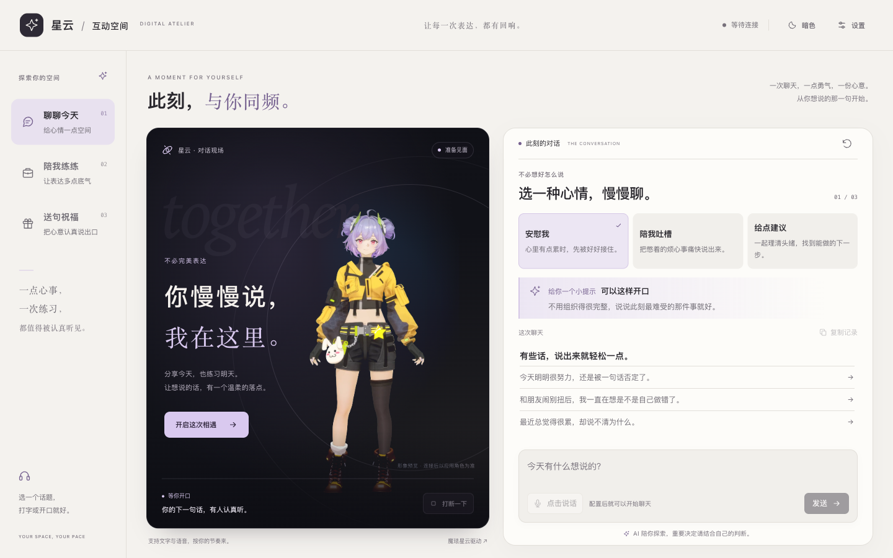
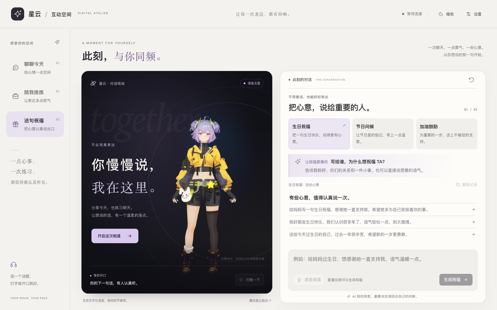

# 星云具身驱动 · 数字人互动工作室

[](https://github.com/likebeans/xingyun3D/actions/workflows/ci.yml)
[](https://github.com/likebeans/xingyun3D/actions/workflows/pages.yml)

这是一个基于魔珐星云 Agent SDK 2.4.1 的桌面 Web 示例。你可以和数字人聊天、完成三轮情景对练，或生成一段由数字人播报的祝福。

前端使用原生 HTML、CSS 和 JavaScript，Node 服务仅使用内置模块，没有第三方 npm 运行依赖。浏览器仍会从星云 CDN 加载 SDK，并连接 Agent、Brain、自动语音识别（ASR）和文本转语音（TTS）服务，因此对话与语音能力不能离线运行。



## 三种玩法

| 玩法 | 你可以做什么 | 页面提供什么 |
| --- | --- | --- |
| 聊聊今天 | 选择安慰、吐槽或建议话题，也可以自由输入 | 文字与麦克风输入、当前页面内的对话记录 |
| 陪我练练 | 完成模拟面试、提涨薪或自我介绍练习 | 三轮提示、进度显示、一个亮点和一个改进建议 |
| 送句祝福 | 生成生日祝福、节日问候或加油鼓励 | 继续修改、复制正文、按原文重新播报 |

播报期间可以点击“打断一下”。页面会停止当前播放并重建连接，保留本次记录、练习轮次和已完成的祝福。打断不能保证取消服务端已经开始的模型生成，并会新增一次连接。

设置面板还保留自定义播报、角色支持的 KA 动作、音量调节、积分查询和亮暗主题。页面按桌面浏览器设计，建议在 1280 px 及以上宽度使用。



## 三步启动

推荐使用 Node.js 24 LTS，支持 Node.js 22 或更高版本。开始前，请在 [魔珐星云应用中心](https://xingyun3d.com) 准备支持新版 Agent 的应用：选择角色与音色，配置 Brain、ASR 和 TTS，确认账号有可用额度，并取得 App ID 与 App Secret。

1. 克隆仓库并创建本地配置：

   ```bash
   git clone https://github.com/likebeans/xingyun3D.git
   cd xingyun3D
   cp .env.example .env
   ```

2. 编辑 `.env`，至少填写以下两项：

   ```dotenv
   XMOV_APP_ID=your_app_id
   XMOV_APP_SECRET=your_app_secret
   ```

3. 启动服务，再打开[本地页面](http://localhost:3000)：

   ```bash
   npm start
   ```

项目没有第三方 npm 依赖，因此不需要先运行 `npm install`。你也可以保留 `.env` 中的凭证为空，启动页面后通过“设置”填写。

## 配置如何生效

页面按以下顺序选择第一组同时包含 App ID 和 App Secret 的配置：

1. **当前浏览器**：在页面“设置”中保存，写入该浏览器的 localStorage。
2. **本地服务**：Node 服务读取 `.env` 或进程环境变量，并通过 `/api/config` 提供给页面。
3. **站点配置**：GitHub Pages 构建时写入公开的 `config.js`。

浏览器配置的优先级最高。清除浏览器配置后，页面会回退到本地服务或站点配置，并在“设置”中显示当前来源。

### 环境变量

| 变量 | 会话必需 | 默认值或用途 |
| --- | --- | --- |
| `XMOV_APP_ID` | 是 | 支持新版 Agent 的应用 App ID |
| `XMOV_APP_SECRET` | 是 | 对应应用的 App Secret |
| `XMOV_GATEWAY_SERVER` | 否 | 默认使用新版 Agent 网关 `/user/v1/ttsa_v2/session` |
| `XMOV_AUTHORIZATION` | 否 | 需要时传给浏览器 SDK 的 `Authorization` 请求头 |
| `PORT` | 否 | Node 服务端口，默认 `3000` |

服务端和页面会把已知的旧默认地址 `/user/v1/ttsa/session` 迁移到新版地址。仍建议更新自己的 `.env`，避免继续依赖兼容逻辑。

### 凭证安全边界

这个项目在浏览器中初始化星云 SDK，因此任何实际用于会话的凭证最终都会到达浏览器：

- `.env` 已被 `.gitignore` 排除，但 Node 模式仍会通过 `/api/config` 把配置交给页面。
- Pages 的仓库 Variables 会写入公开静态文件。Variables 和 Secrets 都不能让嵌入前端的值保持私密。
- 浏览器设置保存在 localStorage，适合访问者使用自己的演示凭证，不应作为高安全等级的密钥存储。
- 对外部署时，请使用独立的演示应用，限制额度与可用范围，不要使用生产凭证。

## 其他运行方式

### Docker

在仓库目录中准备 `.env`，然后使用 Compose 构建并启动：

```bash
cp .env.example .env
# 编辑 .env 后继续
docker compose up -d --build
```

也可以直接使用 GitHub Container Registry（GHCR）镜像：

```bash
docker run --rm -p 3000:3000 \
  --env-file .env \
  ghcr.io/likebeans/xingyun3d:latest
```

`main` 分支更新会发布 `latest`、`main` 和 `sha-<完整提交 SHA>` 标签；创建 `v1.2.3` 这类版本标签会发布 `1.2.3`、`1.2` 和 SHA 标签，版本发布不会覆盖 `latest`。

### GitHub Codespaces

1. 在仓库主页选择 **Code → Codespaces → New codespace**。
2. Codespace 会准备 Node.js 24，并把 `.env.example` 复制为 `.env`。
3. 填写凭证，运行 `npm start`，再打开自动转发的 3000 端口。

### GitHub Pages

[Pages 站点](https://likebeans.github.io/xingyun3D/)是纯静态版本。首次部署前，在仓库 **Settings → Pages** 中把 Source 设为 **GitHub Actions**。

你可以选择一种凭证模式：

- **访问者自带凭证**：不设置仓库 Variables。访问者在页面“设置”中填写自己的 App ID 和 App Secret。
- **公开演示凭证**：在 **Settings → Secrets and variables → Actions → Variables** 中设置 `XMOV_APP_ID` 和 `XMOV_APP_SECRET`，按需设置网关与 Authorization。构建脚本会使用 JSON 序列化生成 `config.js`。

公开演示模式中的值对所有访问者可见，并会消耗对应应用的额度。Pages 不运行 Node 服务，因此不提供 `/api/consume` 积分查询代理。在线页面只反映 `main` 分支最近一次成功部署，本地未推送的改动不会立即出现。

## 验证状态与范围

本地检查可通过以下命令运行：

```bash
npm run check
npm test
```

`npm run check` 检查服务端、前端和工具脚本语法。`npm test` 检查 Pages 无凭证与特殊字符配置构建，并启动隔离的无凭证与假凭证服务，验证配置接口、网关兼容、静态资源和预期错误响应。测试不会向星云发起云端会话；CI 使用 Node.js 22 和 24 分别执行。

已完成的本地验证包括：

- 使用模拟 Agent 驱动聊天、三个三轮练习、点评和三个祝福模板。
- 验证语音最终结果去重、打断后重建、复制与原文重播、旧实例回调隔离。
- 检查 1280 × 800、1440 × 900 和 1920 × 1080 的桌面布局。
- 检查亮暗主题、减少动态效果偏好和设置弹窗的键盘操作。

真实平台验收尚未完成。最近一次真实网关请求返回“您的积分不足”，所以下列项目仍需在额度可用后验证：

- Brain 的真实回答质量。
- 麦克风识别与自动送问。
- TTS 播报和数字人播放。
- 目标应用在真实并发与额度条件下的行为。

模拟测试不代表这些云端能力已经通过验收。手机和平板适配、登录、持久化历史、长久记忆、录屏导出和云端分享不在当前版本范围内。

## 常见故障

| 现象 | 检查与处理 |
| --- | --- |
| 点击开始后打开设置 | 当前没有完整凭证。填写 App ID 和 App Secret，或检查 `.env` 是否由正在运行的服务读取。 |
| 提示“您的积分不足” | 在应用中心检查账号额度。该错误来自云端，重启本地服务不会恢复额度。 |
| 初始化或连接失败 | 检查角色、音色、Brain、ASR、TTS 和网关配置。关闭重复标签页，排除应用并发限制。 |
| 麦克风不可用 | 使用 `localhost` 或 HTTPS，授予录音权限，并检查系统输入设备。 |
| 点击“结束监听”后仍在等待 | 页面正在等待最终识别结果。收到结果后才会继续，10 秒超时会重建连接。 |
| Pages 中不能查询积分 | 这是预期行为。静态站点没有 Node 代理，请在本地或 Docker 模式查询。 |
| 3000 端口已被占用 | 使用其他端口启动，例如 `PORT=3100 npm start`。 |

首次初始化需要下载数字人素材。文本生成完成、语音播报完成和 ASR 结束是不同阶段，请以页面状态为准，不要在等待期间重复提交。

## 项目结构

```text
xingyun3D/
├── .env.example                 # 本地环境变量模板
├── server.js                    # 配置、积分代理和静态文件服务
├── scripts/build-pages.js       # 安全生成 Pages 的公开 config.js
├── public/
│   ├── index.html               # 工作室页面与固定 SDK 引用
│   ├── style.css                # 桌面布局和亮暗主题
│   ├── config.js                # 静态站点配置入口
│   ├── scenes.js                # 聊天、练习与祝福场景
│   ├── sdk-agent.js             # XingyunAvatarAgent 薄封装
│   ├── main.js                  # 页面交互与会话状态
│   └── assets/                  # 本地静态图片
├── .github/                     # CI、Pages、镜像和协作模板
├── .devcontainer/               # Codespaces 配置
├── Dockerfile
└── docker-compose.yml
```

## Agent SDK 接入

项目固定加载：

```text
https://media.xingyun3d.com/xingyun3d/general/litesdk/xmovAvatar_e2e.2.4.1.js
```

主要调用关系如下：

1. `sdk-agent.js` 创建并管理唯一的 `XingyunAvatarAgent` 实例。
2. 文字输入通过 `agent.ask(text)` 进入 Brain 对话链路。
3. 语音输入通过 `startASR()` 和 `stopASR()` 管理采集。
4. AI 文本通过 `onLLMResponse` 回填，整轮播报完成后恢复输入。
5. `interrupt()` 停止当前播报；切换场景或重新开始时销毁旧实例。
6. 固定开场中的 `<uievent>` 触发 Widget `show_text` 提示卡。

查看[新版互动体验开发与验收记录](docs/web-upgrade-plan.md)，或阅读魔珐星云文档：

- [升级指南](https://xingyun3d.com/developers/73-567)
- [安装与集成](https://xingyun3d.com/developers/67-544)
- [文本对话](https://xingyun3d.com/developers/68-547)
- [语音识别](https://xingyun3d.com/developers/68-548)
- [播报与完成事件](https://xingyun3d.com/developers/68-549)
- [打断控制](https://xingyun3d.com/developers/68-550)
- [Widget](https://xingyun3d.com/developers/68-553)
- [Brain 配置](https://xingyun3d.com/developers/72-573)

## 参与项目

提交改动前，请阅读[贡献指南](CONTRIBUTING.md)。发现安全问题时，请按[安全策略](SECURITY.md)中的方式私下报告，不要在公开 Issue 中提交凭证或漏洞细节。

`blog/` 中的文章与截图记录的是升级前的表演控制台和旧 SDK 接法。新版接入请以当前 README、[开发计划](docs/web-upgrade-plan.md)和代码为准。
